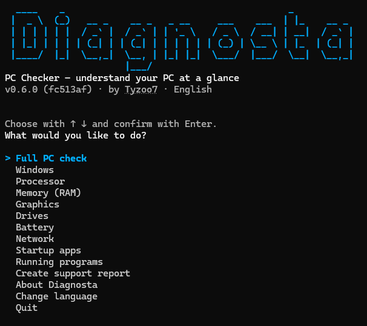
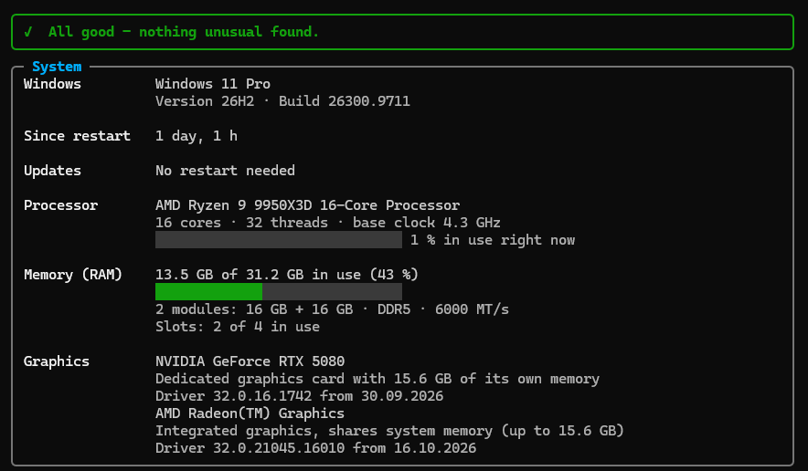

# Diagnosta – PC Checker

[](https://github.com/Tyzoo7/diagnosta/actions/workflows/ci.yml)
[](LICENSE)

[English](README.md) · **Deutsch**

Diagnosta ist ein Diagnose-Tool für Windows, das im Terminal läuft. Es zeigt den Zustand
eines PCs an einem Ort und erklärt die Ergebnisse in verständlicher Sprache, sodass
auch Menschen ohne Technikwissen sie verstehen.

> **Status: Vorabversion auf dem Weg zu 1.0.** Alles unter [Funktionen](#funktionen) funktioniert heute schon.



## Warum noch ein Diagnose-Tool?

Es gibt großartige Spezial-Tools: WizTree für Speicherplatz, CrystalDiskInfo für die
Laufwerksgesundheit, HWiNFO für Hardware. Im IT-Support braucht man aber meistens
**einen schnellen Überblick über alles** und eine Möglichkeit, ihn **weiterzugeben**.
Genau dafür ist Diagnosta gebaut:

- **Ein Tool statt fünf.** Die wichtigsten Prüfungen auf einen Blick.
- **Verständliche Sprache.** „Deine SSD hat 12 % ihrer Lebensdauer verbraucht, alles in Ordnung“ statt roher Messwerte.
- **Ein Bericht zum Weitergeben.** Ein Klick erstellt eine HTML-Datei, die du an ein Support-Ticket anhängen kannst.
- **Deutsch und Englisch.** Das Tool nutzt automatisch deine Windows-Sprache.

## Funktionen

- Menü mit Pfeiltasten und Sprachwahl (Deutsch/Englisch)
- Systemüberblick: Windows-Version, Laufzeit und ausstehender Neustart; CPU-Auslastung und Grundtakt; RAM-Belegung und -Module; Grafikspeicher und -treiber, mit verständlichen Hinweisen
- Laufwerksübersicht: SSD/HDD, Modell, freier Platz, Warnung wenn fast voll
- Laufwerkszustand: gesund / Warnung / defekt, wie von Windows gemeldet (ohne Admin-Rechte)
- Akku-Verschleiß bei Laptops
- Netzwerkadapter: Geschwindigkeit, IP-Adresse, Router, DNS (ohne Internetzugriff, ohne Standortabfrage)
- Autostart-Programme wie im Task-Manager
- Laufende Programme mit dem meisten RAM- und CPU-Verbrauch
- Support-Bericht: eine HTML-Datei zum Anhängen an ein Ticket, standardmäßig anonymisiert

### Geplant nach 1.0

- Speicheranalyse: größte Ordner und Dateien
- Aufräum-Vorschläge: Temp-Dateien, Update-Cache, Papierkorb
- Absturz-Verlauf: Bluescreens und unerwartete Neustarts

## Support-Bericht

**Support-Bericht erstellen** im Menü (oder `diagnosta --report`) speichert eine HTML-Datei auf
dem Desktop, die man an ein Ticket oder eine E-Mail anhängen kann. Zuerst kommen die Hinweise,
danach alle Details.

- **Standardmäßig anonymisiert:** Die eigene IP-Adresse des PCs wird gekürzt (`192.168.1.xxx`),
  Laufwerksnamen werden weggelassen. Benutzer- und PC-Namen liest Diagnosta gar nicht erst aus.
- **Sicher zu öffnen:** Alle Werte sind HTML-kodiert, und eine Content-Security-Policy verbietet
  Skripte und Anfragen nach außen. Die Datei enthält kein JavaScript und lädt nichts aus dem Internet.

## Grundsätze

- **Nur lesen.** Diagnosta liest nur. Künftige Aufräum-Funktionen löschen nichts ohne ausdrückliche Bestätigung, und nur in den Papierkorb.
- **Kein Netzwerkzugriff, keine Telemetrie.** Diagnosta sendet nie Daten irgendwohin.
- **Keine Admin-Rechte.** Alles funktioniert als normaler Benutzer. Falls eine künftige Prüfung sie je braucht, erklärt das Tool, warum.
- **Wenige Abhängigkeiten, feste Versionen.** So bleibt die Angriffsfläche klein.

## Was es heute zeigt



_Die Bilder zeigen die englische Ansicht; auf Deutsch sieht alles gleich aus._

Alle Werte werden über Windows-eigene Schnittstellen gelesen (Registry, kernel32, DXGI,
Speicher-IOCTLs, WMI). Dafür braucht es weder Admin-Rechte noch zusätzliche Pakete. Grafikspeicher
über 4 GB wird korrekt angezeigt, anders als bei Tools, die auf WMI basieren.
Seriennummern von Laufwerken werden nie ausgelesen.

## Download

Lade die neueste `Diagnosta-vX.Y.Z-win-x64.exe` von der
[Releases-Seite](https://github.com/Tyzoo7/diagnosta/releases) herunter. Es ist eine
einzelne Datei mit etwa 14 MB, ohne Installation und ohne .NET-Laufzeit. Sie läuft unter
64-Bit-Windows 10 und 11.

1. Öffne ein Terminal im Download-Ordner und starte `.\Diagnosta-v0.5.0-win-x64.exe`
   (mit dem Namen der heruntergeladenen Version). Ein Doppelklick funktioniert auch: Das
   Fenster bleibt offen, bis du Esc drückst oder es schließt.
2. Optional kannst du prüfen, ob die Datei echt ist: Vergleiche
   `Get-FileHash .\Diagnosta-v0.5.0-win-x64.exe` mit dem Wert in `SHA256SUMS.txt`
   aus demselben Release. Releases aus der Zeit, in der das Repository öffentlich ist,
   lassen sich zusätzlich mit `gh attestation verify` prüfen (siehe [SECURITY.md](SECURITY.md)).

Die .exe ist noch nicht code-signiert, deshalb warnt Windows SmartScreen beim ersten Start
eventuell. Versionen unter 1.0 sind als Vorabversion (Pre-release) markiert.

Jeder CI-Lauf baut außerdem eine Test-.exe (**Actions → CI → Artifacts**), um Änderungen
vor einem Release auszuprobieren.

## Verwendung

Ohne Optionen im Terminal (oder per Doppelklick) gestartet, fragt Diagnosta nach der Sprache
und zeigt dann ein Menü: Mit den Pfeiltasten den kompletten PC-Check oder einen einzelnen
Bereich wählen und mit Enter bestätigen.

```text
diagnosta                 Menü öffnen
diagnosta --full          Kompletten PC-Check sofort ausgeben (auch bei umgeleiteter Ausgabe)
diagnosta --report        Anonymisierten Support-Bericht (HTML) auf dem Desktop speichern
diagnosta --lang de       Auf Deutsch (de) oder Englisch (en) starten
diagnosta --help          Alle Optionen anzeigen
diagnosta --version       Version anzeigen
```

## Aus dem Quellcode bauen

Benötigt das [.NET 10 SDK](https://dotnet.microsoft.com/download/dotnet/10.0).

```bash
git clone https://github.com/Tyzoo7/diagnosta.git
cd diagnosta
dotnet test                          # bauen und alle Tests ausführen
dotnet run --project src/Diagnosta   # Programm starten
```

## Release erstellen

1. `<Version>` in `src/Diagnosta/Diagnosta.csproj` per Pull Request erhöhen und mergen.
2. **Actions → Release → Run workflow** öffnen und dieselbe Version eingeben, z. B. `0.5.0`.
3. Der Workflow prüft die Eingabe (Format, passt zu `<Version>`, noch nicht veröffentlicht),
   führt die Tests aus, baut die .exe und veröffentlicht ein GitHub-Release mit der .exe und
   `SHA256SUMS.txt`. Den Tag `v0.5.0` setzt GitHub auf genau den Commit, der gebaut wurde.
   Sobald das Repository öffentlich ist, fügt der Workflow auch einen Herkunftsnachweis
   (Build Provenance Attestation) hinzu.

## Projektstruktur

```text
src/Diagnosta/            Das Programm
  Checks/                 Macht aus Rohwerten verständliche Hinweise
  Cli/                    Auswertung der Kommandozeile
  SystemInfo/             Liest Systeminformationen aus Windows
  Localization/           Übersetzungen (Strings.resx = Englisch, Strings.de.resx = Deutsch)
  Ui/                     Ausgabe in der Konsole
tests/Diagnosta.Tests/    Automatische Tests (xUnit)
.github/workflows/        CI (bauen und testen auf Windows), Release, CodeQL
```

## Sicherheit

Bitte melde Sicherheitsprobleme privat, nicht als öffentliches Issue. Wie das geht und was
Diagnosta tut und nicht tut, steht in [SECURITY.md](SECURITY.md) (auf Englisch).

## Lizenz

[MIT](LICENSE) © Tyzoo7
